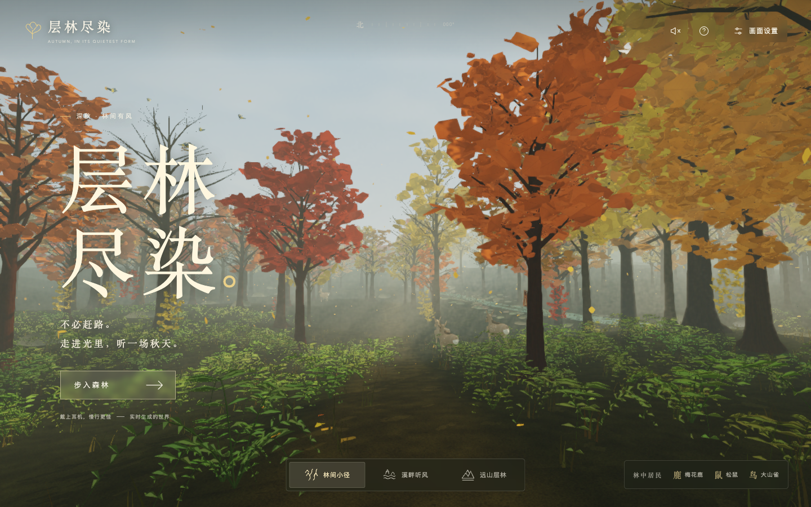

# 层林尽染 · 秋日森林漫游

一个纯 **HTML + CSS + JavaScript + 原生 WebGL2** 的秋日森林互动作品。所有树木、地形、叶片、蕨类、溪水、纹理、粒子和声音都在本地程序生成，无 Three.js、无模型库、无外部图片、无运行时 npm 依赖。



**在线漫游：[https://hawzz.github.io/autumn-forest/](https://hawzz.github.io/autumn-forest/)**

## 打开方式

直接用新版 Chrome / Edge / Firefox / Safari 打开 `index.html` 即可。请开启浏览器硬件加速。

也可以运行本地静态服务：

```bash
node test/server.cjs
```

然后访问 `http://localhost:4173`。若该端口被占用，可以运行：

```bash
PORT=4174 node test/server.cjs
```

## 操作

| 操作 | 功能 |
| --- | --- |
| 点击“步入森林” | 开始漫游并请求鼠标锁定 |
| WASD / 方向键 | 移动 |
| 鼠标 | 环顾；无法锁定鼠标时可按住左键拖动 |
| Shift | 快走 |
| Space | 跳跃 |
| Esc | 释放鼠标；点击“继续漫游”或 Enter 恢复 |
| 左侧移动区 + 右侧拖动区 | 触屏双指同时移动和环顾 |
| 底部三个观景点 | 林间小径 / 溪畔听风 / 远山层林 |
| 画面设置 | 自动 / 细腻 / 均衡 / 流畅，风力、体积光、反射、脚步起伏 |
| 声音按钮 | 开启合成风声、叶声与鸟鸣；默认静音 |
| 右侧“林中居民” | 观察梅花鹿、松鼠、大山雀；只观察，不操控动物 |
| Q / E | 在同类动物间切换观察对象 |
| V / Esc | 返回原来的第一人称位置与朝向 |
| 观察时拖动 / 滚轮 | 绕看动物 / 调整距离，不改变动物行动 |

## 林中居民与生态观察

- **梅花鹿**：连续胸腹、倾斜肩颈、分节四肢、分蹄与柔和冬毛斑点；雄鹿有分叉角。雌鹿与幼鹿取食、漫步、警戒和休息，雄鹿较独立。玩家快走或靠近时会触发警戒与逃离。
- **欧亚红松鼠**：红褐绒毛、冬季耳簇、浅色腹部、连续弯曲尾巴与抓握橡实的前爪。下树觅食、啃食、储藏、沿真实树干剖面攀行，受惊时返回树上。
- **大山雀**：白颊、黄腹黑纵纹、蓝灰翼面、翼骨驱动的分级飞羽、细喙与尾羽。枝头啄食、理羽、短程飞行，按固定巢位归巢，不会凭空消失。
- **归巢行为**：飞抵巢缘 → 收翼张望 → 整理羽毛 → 整理巢材 → 分享食物 → 收翅停栖，之后在清晨离巢。深秋以旧巢/树洞停栖为主，不虚构繁殖孵蛋。
- 鸟类、兽类与玩家始终处于**同一个连续森林和同一坐标系**，没有场景副本、独立分区或动物驾驶模式。观察相机可见原玩家位置标记，返回不会改变玩家的位置或朝向。
- 观察时仅对目标前方窄视线通道内的枝叶/树干进行局部 screen-door 柔化，露出鸟巢与贴树动物；正常漫游保持实体遮挡，不整树隐藏。
- 日内周期压缩为约 10 分钟，便于在一次漫游中观察觅食与归巢，不是实时昼夜。

### 动物模型说明

`js/anatomy.js` 使用连续截面曲面、肩髋—关节—蹄爪链、耳廓、轮廓毛簇和独立羽片生成动物；`js/nest.js` 以弯曲细枝编织鸟巢。**不使用椭球拼接的动物占位模型，也不使用图片或下载模型。**

这些是适合实时漫游的程序化风格化模型，并非扫描级写实资产；毛发采用几何毛簇与轮廓细节近似，不模拟逐根毛发动力学。生态参考：

- [Animal Diversity Web · Cervus nippon](https://animaldiversity.org/accounts/Cervus_nippon/)：冬毛、体色、白臀斑、雌幼群体与警戒行为。
- [Our Jiangsu · 梅花鹿冬毛报道](https://www.ourjiangsu.com/a/20231127/1701065303298.shtml)：冬季深色毛发与斑点减弱。
- [Animal Diversity Web · Sciurus vulgaris](https://animaldiversity.org/accounts/Sciurus_vulgaris/)：冬耳簇、藏食、树洞巢与昼夜活动。
- [Great tit · Parus major](https://en.wikipedia.org/wiki/Great_tit)：白颊黄腹、秋冬食物、混群觅食与洞穴营巢。

## 场景与实现

### 程序建模

- 固定种子的温带混交林：枫树、银杏、栎树三种物种，每种四个独立的树形变体；主干分叉、冠幅、枝向和叶簇疏密不同。
- 分段渐细、平滑弯曲的主干与非等距分枝，树干碰撞复用对应变体的剖面。
- 近景叶片使用多行截面、上下表面和细侧缘，具有真实厚度；叶片的大小、扭转、下垂、左右不对称、边缘锯齿和叶簇位置独立变化。
- 枫叶保留掌状裂片、银杏保留扇形、栎叶保留波状边缘；远景使用有曲率的低成本叶簇，不复制完整厚度网格。
- 连续噪声高度场、蜿蜒泥径、地形驱动溪流、远山、成片蕨类、草叶、落叶、岩石与倒木。
- Canvas 生成树皮、土壤与岩石纹理，叠加沿树干方向的沟槽、曲面法线、叶脉和透光。
- 实例化批量绘制、视锥剔除、近景/远景分级与距离淡出；不再让全屏高密度小草覆盖地面。

### 光照与物理反馈

- HDR 线性光照、半球环境光、太阳方向光、叶片透光和接触遮蔽。
- 双层 1536² 真实深度阴影，覆盖玩家周围的遮挡物而非仅当前视锥；级联边缘平滑过渡，阴影 pass 与主 pass 共用风场。
- **稳定体积散射**：半分辨率视线采样、Henyey–Greenstein 相函数、真实阴影遮挡与固定空间采样；不使用逐帧白噪声制造颗粒。
- **地形水文**：水位沿河道单调下降，坡度、局部河床起伏与水深决定流速和流向；实际河床高差形成岸线、浅滩、急流段和汇流缓流区。
- **局部紊流**：速度剪切产生交错涡旋，网格水面存在厘米级波峰波谷；水中障碍造成沿下游衰减的尾流与局部回流，细部法线和反光共享同一流场时间。入水位置产生扩散波纹。
- **真实水面反射**：水面按深度测试绘制透明几何，反射射线读取独立场景颜色与米制距离，只命中真实可见遮挡物；不会将反射投射到陆地或让水穿过前方树干。
- 入水位置产生扩散波纹，水流细部法线随局部流场传播；岸边透明度由实际水深决定。
- 正确方向性 FXAA、ACES 色调映射、轻量 bloom 和空气透视，不依赖强锐化、浓雾或曝光掩盖几何。
- 共享风场驱动枝叶与草叶摆动；落叶有飘落、旋转、侧风、贴地停留与淡出生命周期。
- 固定 120Hz 玩家步进：平滑加减速、重力、跳跃、坡度与眼高平滑、可关闭的脚步起伏。
- 树干按真实变体分段生成圆柱碰撞，岩石与倒木碰撞；空间网格查询与滑动碰撞。
- Web Audio 合成风、叶声与短促鸟鸣，不下载音频文件。

**技术边界：** 这是实时光栅化 + 阴影遮挡体积散射 + 屏幕空间反射，不是全场景离线路径追踪。水流采用地形坡度、深度与障碍驱动的局部流场和波纹，不是完整的 Navier–Stokes 求解器；屏幕外物体无法被完整反射。

## 性能与验证

正式验收脚本 `test/acceptance.cjs` 已断言通过：

- 桌面初始化、所有 GLSL 编译链接、帧缓冲与 `gl.getError() === 0`。
- 三处观景点与画质切换、体积光/反射开关、风力和声音开关。
- 树干实际接触、不穿透并自然滑动；跳跃后落地。
- 浅水状态与带位置、时间、强度的涟漪。
- 390×844 触屏布局与双指同时前进/转向。
- `file://` 直接打开，无网络依赖。
- `test/final-validation.json` 保存本次验收结果。
- `test/ecology-acceptance.cjs` 验证动物观察视角、相机返回、归巢后多个行为、实际离巢飞行与最大离巢距离、移动端观察及 WebGL 状态；结果保存于 `test/ecology-validation.json`。
- `test/physics-validation.cjs` 验证水位沿地形单调下降、局部流场、树干碰撞与树形变体。
- `test/motion.cjs` 连续移动并逐段截图，检查黑斑、遮挡和帧率。
- `test/stream.cjs` 连续截取同一机位的动态溪流，检查流动、交错波面与反射。

在本机 **Apple M4 Pro / ANGLE Metal / Chrome / 1440×900** 的硬件实测中，连续快走漫游约 **120 FPS**（受显示器刷新率限制）；典型画面约 **2.5–3.3M 三角面、47–49 次绘制调用**，自动分辨率会在稳定窗口内缓慢调整。该数字仅代表本机、该视角与时段，不保证所有设备相同。自动画质使用 180 帧观察窗口和 4 秒切换冷却；普通设备可手动选择“流畅”。

测试脚本依赖 `test/node_modules` 中仅供开发测试使用的 Playwright；正式应用不加载它。测试默认使用本机 Chrome for Testing 与 Metal。若在其他电脑复跑，请修改脚本中的浏览器路径与服务地址。

## 文件结构

```text
index.html          语义化入口与 HUD
style.css           全屏界面、触屏与响应式布局
js/math.js          矩阵、向量、噪声与固定随机数
js/textures.js      Canvas 程序纹理
js/vegetation.js    树木、叶片、蕨类与地形网格
js/world.js         地形真源、森林分布、观景点与碰撞网格
js/shaders.js       GLSL ES 3.00 着色器
js/renderer.js      WebGL2 实例化与多通道渲染
js/physics.js       固定步长玩家运动与碰撞
js/anatomy.js       连续动物曲面、毛簇、羽片与关节链
js/ecology.js       自主行为、警戒、攀树与归巢状态机
js/observer.js      第三人称观察相机与局部目标跟随
js/nest.js          连续细枝编织鸟巢
js/wildlife.js      动物动态实例、关节渲染与阴影
js/main.js          输入、声音、UI 与生命周期
test/acceptance.cjs 正式浏览器验收
test/ecology-acceptance.cjs 动物行为与观察验收
test/server.cjs     无依赖本地静态服务
```

所有画面均由代码实时生成，可自由修改树种、秋色、地形、风力与光照参数。
